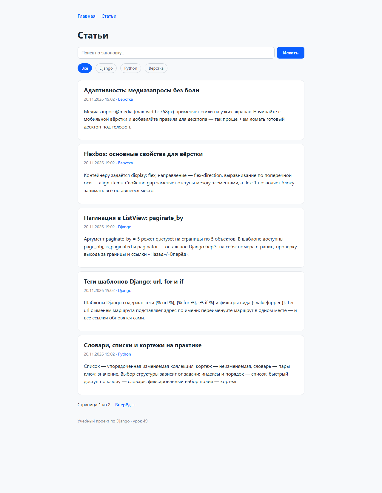
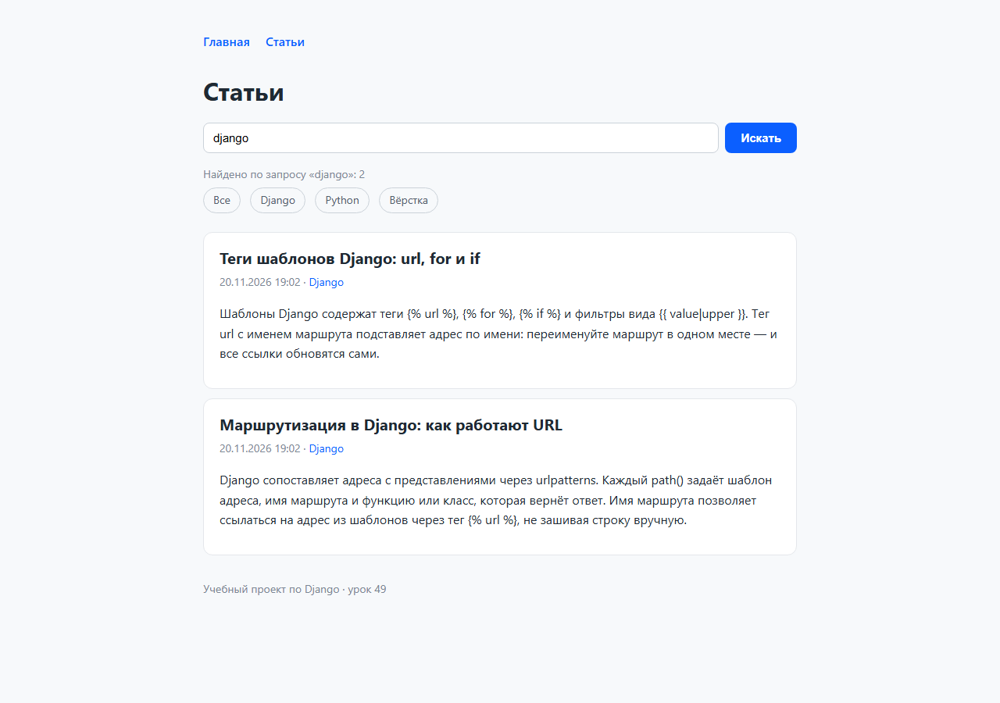
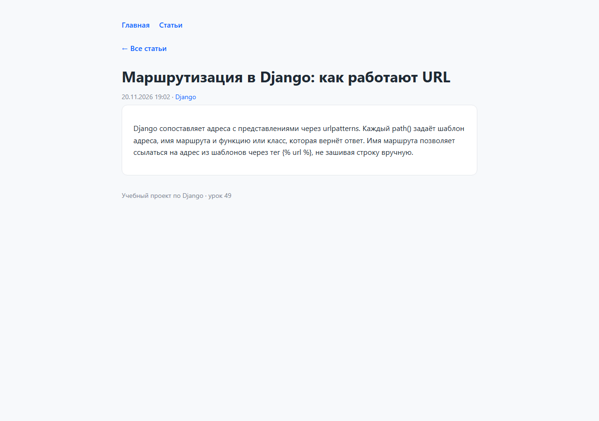
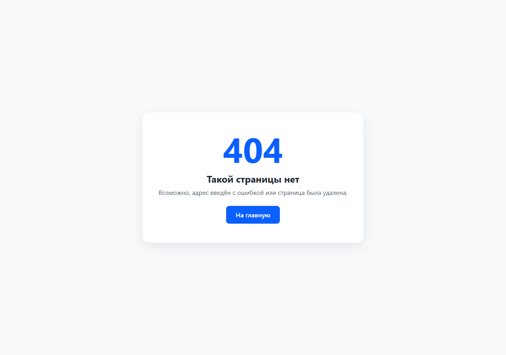
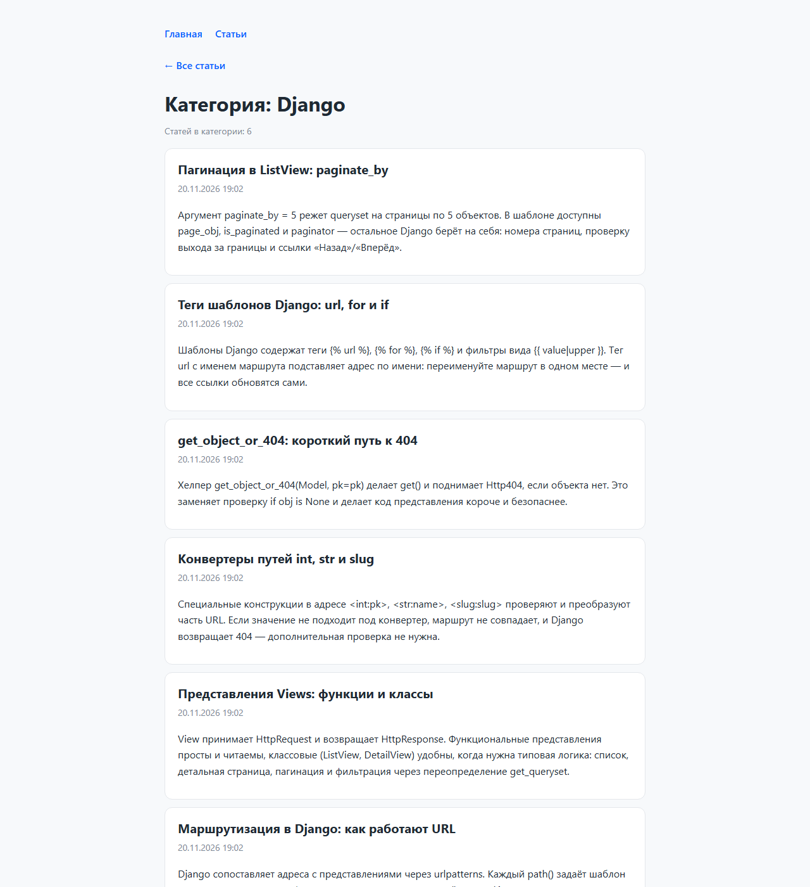

# Отчёт по домашнему заданию: Урок 49 — Маршрутизация (URLs) и логика представлений (Views)

Приложение: `articles`, проект `config`, Django 6.1.3.

## Уровень 1 — База

`articles/models.py`, модель `Article`:

* `title` (`CharField`), `text` (`TextField`), `created_at` (`DateTimeField`, `auto_now_add=True`);
* сортировка `('-created_at', 'id')` — новые статьи сверху;
* `get_absolute_url()` возвращает именованный маршрут `article_detail`.

`articles/urls.py`:

```python
path('articles/', views.ArticleListView.as_view(), name='article_list'),
path('articles/<int:id>/', views.ArticleDetailView.as_view(), name='article_detail'),
```

Детальная страница — `ArticleDetailView` (`DetailView`). Несуществующая
статья отдаёт 404 через `get_object_or_404` (вызов показан явно в
`get_object()`, как в примере урока). Нечисловой id (`/articles/abc/`)
не совпадает с конвертером `<int:id>` — тоже 404.

## Уровень 2 — Практика

**Поиск** — `ArticleListView.get_queryset()`: если в запросе есть `?q=`,
фильтруем `title__icontains=q`. Запрос возвращается в контекст как `q`,
чтобы подставить его в поле формы и в ссылки пагинации.

**Категории** — модель `Category` (`name`, `slug` со `unique=True`) и
связь `Article.category = ForeignKey(Category, related_name='articles')`.
Маршрут и представление:

```python
path('category/<slug:slug>/', views.category_detail, name='category_detail')
```

`category_detail` — функциональное представление: `get_object_or_404(Category, slug=slug)`,
страница неизвестной категории — 404.

**Именованные маршруты.** Все ссылки в шаблонах собираются через
``: навигация (`home`, `article_list`), карточки статей
(`article_detail`), категории (`category_detail`), форма поиска,
ссылки пагинации и кнопка «На главную» на странице 404
(`templates/404.html`). Зашитых адресов в шаблонах нет — это проверяет
тест `test_templates_contain_no_hardcoded_article_links`, который
читает исходники `.html` и ищет `href="/articles/` / `href="/category/`.

## Уровень 3 — Челлендж

Список и детальная страница переписаны на классовые представления:

* `ArticleListView(ListView)` с `paginate_by = 5` — страница режет
  queryset на 5 статей, в шаблоне работают `page_obj`, `is_paginated`,
  `paginator`;
* `ArticleDetailView(DetailView)` — контекст `article`.

Пагинация сохраняет поисковый запрос: ссылки вида
`?q={{ q|urlencode }}&page=2`.

## Демо-данные

Миграция `articles/0002_seed_articles.py` создаёт 3 категории
(Django, Python, Вёрстка) и 10 статей — после `clone` + `migrate`
список не пустой, пагинация и поиск сразу проверяемы.

## Критерии оценки

| Критерий | Где сделано | Баллы |
|---|---|---|
| Список и детальная страница | `ArticleListView`, `ArticleDetailView`, 404 через `get_object_or_404` | 3 |
| Поиск и категории | `?q=` в `get_queryset()`, `Category` + `<slug:slug>` | 3 |
| Именованные маршруты | `name=` во всех маршрутах, `` во всех шаблонах | 2 |
| Челлендж | `ListView`/`DetailView` + `paginate_by = 5` | 2 |

## Проверка

```
python manage.py test        # 30 тестов, OK (articles: 17, shop: 9, books: 5... итого 30)
python manage.py check       # без ошибок
```

Тесты `articles/tests.py` покрывают: список, пагинацию по 5, поиск по
заголовку (в т.ч. пустые результаты), детальную страницу, 404 для
несуществующей и нечисловой статьи, страницу категории и 404 для
неизвестного слага, `reverse()` для всех трёх маршрутов, отсутствие
зашитых адресов в шаблонах и собственную страницу 404 при `DEBUG=False`.

## Скриншоты

| Список (пагинация) | Поиск `?q=django` |
|---|---|
|  |  |

| Статья | 404 |
|---|---|
|  |  |

| Категория `/category/django/` |
|---|
|  |

## Запуск

```
python manage.py migrate     # включая seed демо-данных
python manage.py runserver
```

| Адрес | Что показывает |
|---|---|
| http://127.0.0.1:8000/articles/ | список статей, поиск, пагинация |
| http://127.0.0.1:8000/articles/1/ | детальная страница статьи |
| http://127.0.0.1:8000/articles/999999/ | 404 (собственный шаблон при `DEBUG=False`) |
| http://127.0.0.1:8000/category/django/ | статьи категории Django |
