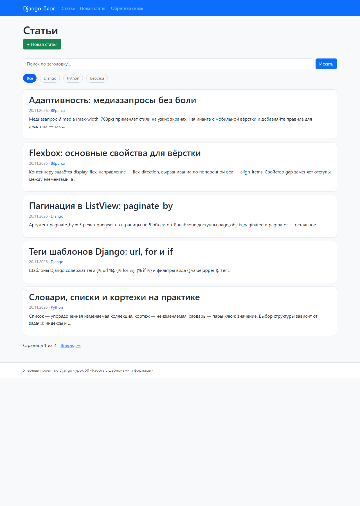
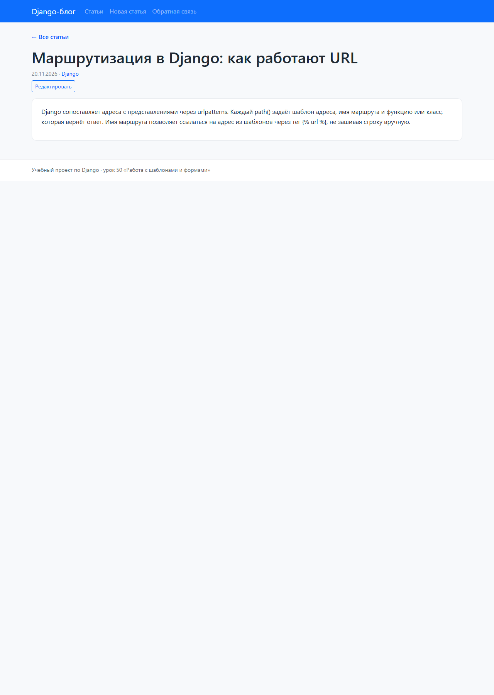
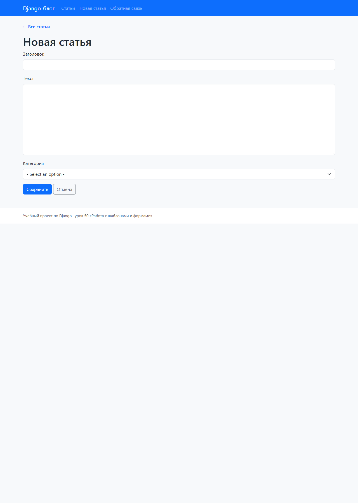
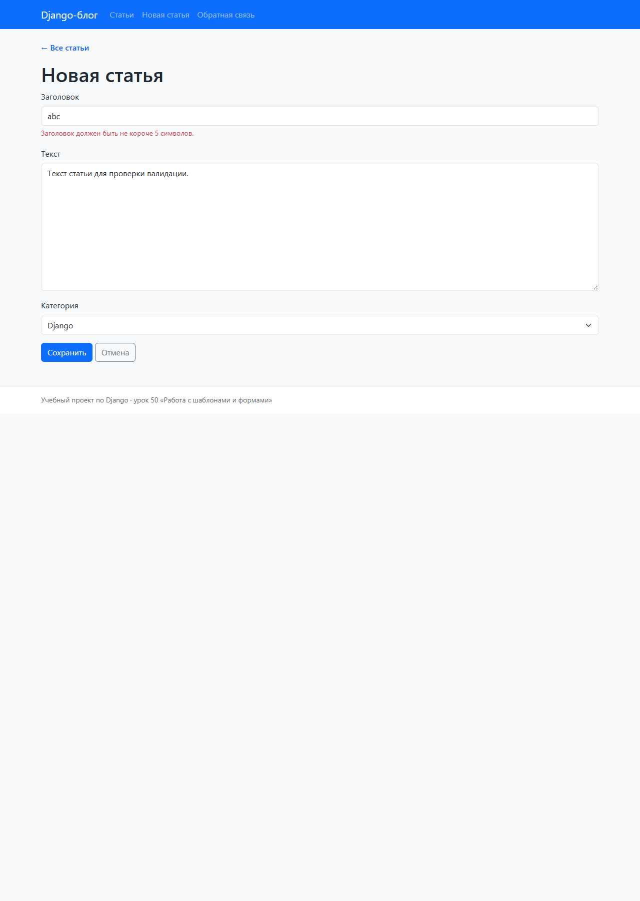
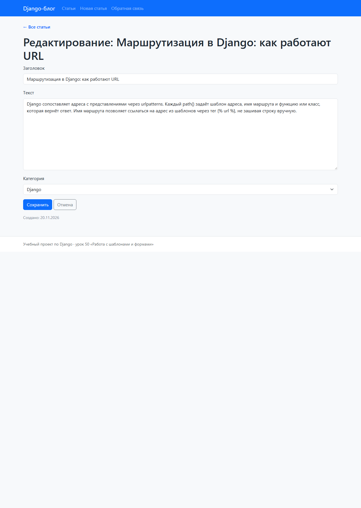
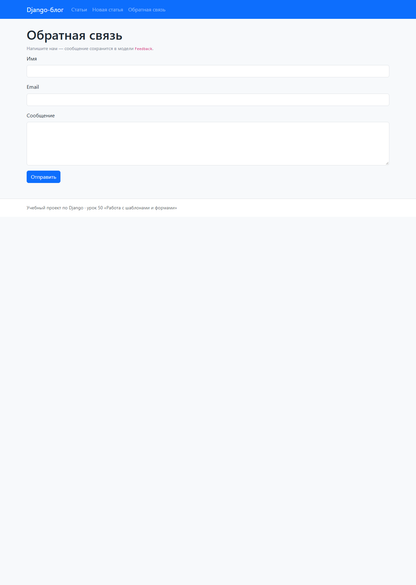
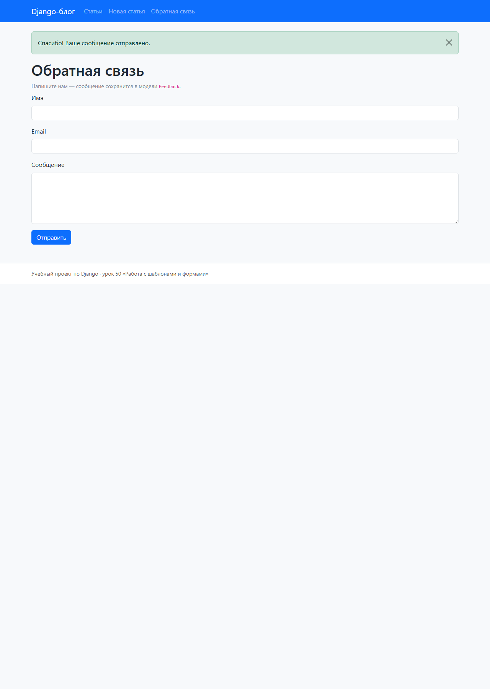

# Отчёт по домашнему заданию: Урок 50 — Работа с шаблонами и формами

Приложение: `articles`, проект `config`, Django 6.1.3.

## Уровень 1 — База

**Наследование шаблонов.** `templates/base.html` — общий каркас: шапка
(Bootstrap-навигация с меню «Статьи», «Новая статья», «Обратная связь»),
блок `` и подвал. Все страницы блога наследуют его через
``:

* список статей, детальная страница, категория;
* форма создания/редактирования, форма обратной связи;
* своя страница `templates/404.html` (тоже переписана на наследование).

Ссылки в шаблонах — только через `` (маршруты `article_list`,
`article_detail`, `article_create`, `article_edit`, `feedback`,
`category_detail`, `home`), зашитых адресов нет — это проверяет существующий
тест `test_templates_contain_no_hardcoded_article_links`.

**Формат даты и превью.** В списках и категории:

```django
{{ article.created_at|date:"d.m.Y" }}     {# дд.мм.гггг, без времени #}
{{ article.text|truncatewords:20 }}       {# превью на 20 слов + … #}
```

## Уровень 2 — Формы

**`articles/forms.py`** — `ArticleForm(forms.ModelForm)`:

```python
class ArticleForm(forms.ModelForm):
    class Meta:
        model = Article
        fields = ['title', 'text', 'category']

    def clean_title(self):
        title = self.cleaned_data['title']
        if len(title) < 5:
            raise forms.ValidationError(
                'Заголовок должен быть не короче 5 символов.'
            )
        return title
```

**Маршруты и представления** (`articles/urls.py`, `articles/views.py`):

```python
path('articles/new/', views.article_create, name='article_create'),
path('articles/<int:id>/edit/', views.article_edit, name='article_edit'),
```

* `article_create` — `ArticleForm(request.POST or None)`: GET отдаёт пустую
  форму, валидный POST сохраняет статью и делает `redirect('article_detail')`;
* `article_edit` — та же форма с `instance=article` (значения предзаполнены),
  после сохранения — редирект на детальную страницу;
* несуществующая статья — 404 через `get_object_or_404`.

**Ошибки под полем.** Шаблон `articles/form.html` рендерит поля в цикле
``: под каждым полем при `field.errors` выводится
`<div class="invalid-feedback d-block">` с текстом ошибки — сообщение
`clean_title` видно прямо под полем заголовка.

## Уровень 3 — Челлендж ⭐

**Модель `Feedback`** (`articles/models.py`, миграция `0003_feedback`):
`name`, `email`, `message`, `created_at`; зарегистрирована в админке.

**`FeedbackForm(forms.Form)`** — обычные поля `name`, `email`, `message`
(текстовое поле — `Textarea`), метод `save()` создаёт запись в `Feedback`.

**Представление `feedback`** (`/feedback/`): валидный POST сохраняет
сообщение, добавляет `messages.success(request, 'Спасибо! Ваше сообщение
отправлено.')` и делает `redirect('feedback')` (паттерн PRG — повторная
перезагрузка не отправит сообщение дважды). В `base.html` блок выводит
`django.contrib.messages` в виде Bootstrap-алертов.

**Bootstrap через CDN** — в `base.html`:

```html
<link href="https://cdn.jsdelivr.net/npm/bootstrap@5.3.3/dist/css/bootstrap.min.css" rel="stylesheet">
...
<script src="https://cdn.jsdelivr.net/npm/bootstrap@5.3.3/dist/js/bootstrap.bundle.min.js"></script>
```

Хелпер `add_bootstrap()` в `forms.py` добавляет полям классы
`form-control` / `form-select`, поэтому все формы выглядят аккуратно.

## Критерии оценки

| Критерий | Где сделано | Баллы |
|---|---|---|
| Наследование шаблонов | `base.html` + `` на всех страницах, дата `d.m.Y`, превью `truncatewords:20` | 2 |
| Создание и редактирование через ModelForm | `/articles/new/`, `/articles/<id>/edit/` (instance=), `ArticleForm` | 4 |
| Валидация и вывод ошибок | `clean_title` (≥ 5 символов), ошибки под полем в `form.html` | 2 |
| Челлендж | `FeedbackForm` + модель `Feedback` + `messages` + Bootstrap CDN | 2 |

## Проверка

```
python manage.py test        # 46 тестов, OK (articles: 33)
python manage.py check       # без ошибок
```

Новые тесты в `articles/tests.py`:

* `TemplateInheritanceTests` — страницы содержат навигацию `base.html`,
  дата в формате `дд.мм.гггг`, превью обрезается на 20 слов;
* `ArticleCreateTests` — GET формы, создание валидной статьи, ошибка при
  заголовке короче 5 символов (статья не создаётся, ошибка под полем);
* `ArticleEditTests` — предзаполненная форма с `instance=`, обновление,
  404 для несуществующей статьи;
* `FeedbackTests` — сохранение в `Feedback` + сообщение об успехе, отказ
  при неверном email, `clean_title` и обязательные поля формы.

## Скриншоты

| Список `/articles/` | Статья `/articles/1/` |
|---|---|
|  |  |

| Новая статья `/articles/new/` | Ошибка валидации |
|---|---|
|  |  |

| Редактирование `/articles/1/edit/` | Обратная связь `/feedback/` |
|---|---|
|  |  |

| Сообщение об успехе |
|---|
|  |

Скриншоты сняты скриптом `make_screenshots.py` (headless Chrome; POST-ответы
рендерятся через `django.test.Client`).

## Запуск

```
python manage.py migrate     # включая 0003_feedback
python manage.py runserver
```

| Адрес | Что показывает |
|---|---|
| http://127.0.0.1:8000/articles/ | список: дата, превью 20 слов, кнопка «Новая статья» |
| http://127.0.0.1:8000/articles/new/ | создание через ModelForm |
| http://127.0.0.1:8000/articles/1/edit/ | редактирование (та же форма с instance=) |
| http://127.0.0.1:8000/feedback/ | форма обратной связи (модель Feedback + messages) |
| http://127.0.0.1:8000/articles/999999/ | 404 (наследует base.html) |
